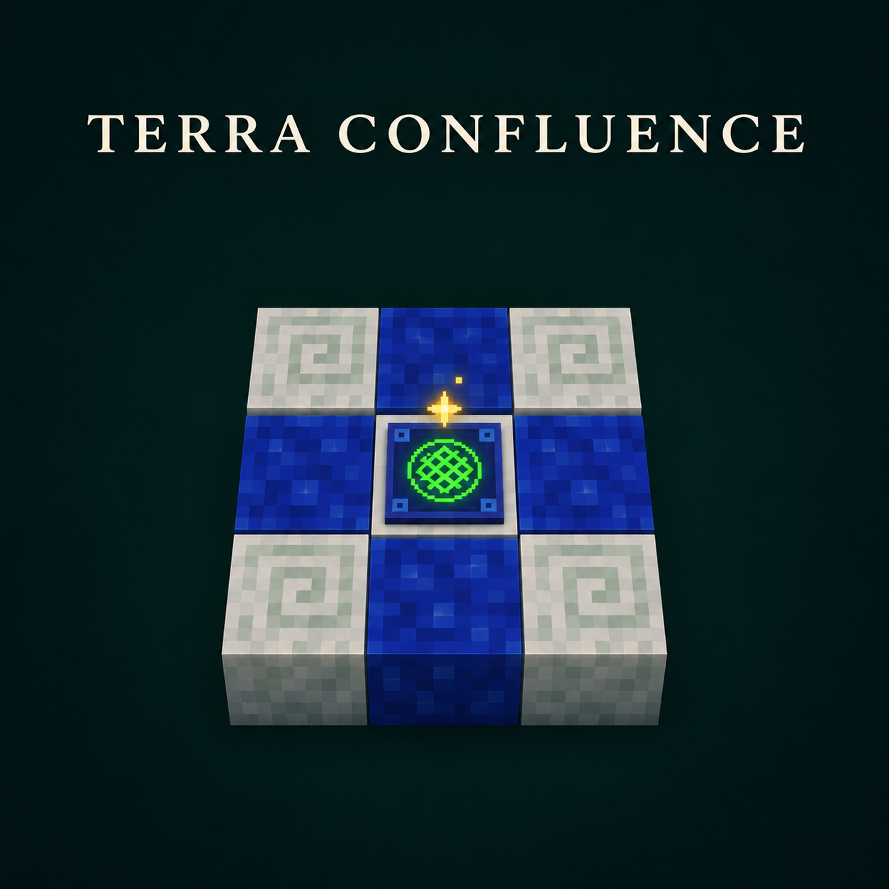

# Terra Confluence · 泰拉凝炼

**Minecraft 1.20.1 · Forge · Java 17**

泰拉凝炼为植物魔法（Botania）的泰拉凝聚板加入可自定义的配方。整合包作者可以指定投料、魔力消耗、产物，以及凝聚板下方的方块或流体。配方完成时，还能把指定位置转化成另一种方块或流体。

[下载模组][release] · [使用教程](docs/使用教程.md) · [KubeJS 示例](kubejs-examples/) · [从源码构建](docs/构建.md)

## 能做什么

- **设计凝聚板平台。** 在板下 3×3 范围内设定布局、方块状态和流体条件。非对称布局可以旋转摆放。
- **让合成改变平台。** 逐格指定结果，或一次转化配方中要求的全部位置。
- **沿用 Botania 火花供能。** 魔力由附近的魔力池和火花网络传入，原版泰拉钢配方照常可用。
- **在 JEI 查看配方。** 「泰拉凝炼」类别展示投料、魔力消耗和平台转化前后的布局。

## 开始使用

在 Minecraft 1.20.1 的 Forge 实例里安装本模组和 Botania，并装齐 Botania 所需的 Patchouli、Curios API。JEI 和 KubeJS 是可选联动。模组提供配方类型 `terra_plate_extension:terra_plate`，自定义配方由整合包通过数据包或 KubeJS 加入。

想验证安装是否成功，可以跟着[第一条配方](docs/使用教程.md#第一条配方)做一次合成。教程用两颗黏土球换取一块红砖，并把凝聚板正下方的石头转化为圆石。

## 许可与致谢

项目源码采用 [MIT 许可](LICENSE)。感谢 Vazkii 和 Botania 团队，以及 Botania Tweaks 作者 quat。复用的 JEI 纹理及其许可证见[第三方声明](THIRD_PARTY_NOTICES.md)。

[release]: https://github.com/xiansi506/terra-confluence/releases
